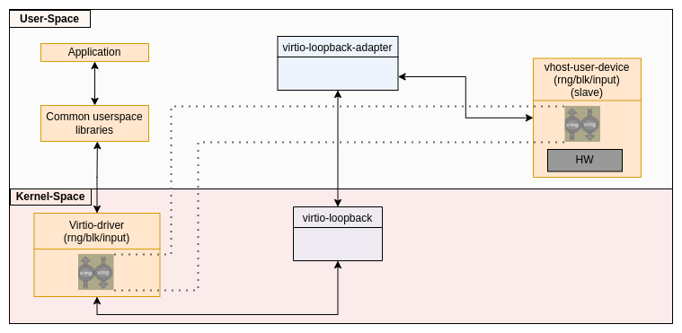

# 1. Introdunction
This guide contains the results of the activity carried on by Virtual Open Systems in the [Automotive Grade Linux](https://www.automotivegradelinux.org) community and specifically in the Software Define Vehicles expert group (SDV-EG). Both code and documentation included in this guide are intended to be used to familiarize with the concept of virtio-loopback and to give developers the opportunity to test it.

# 2. virtio-loopback overview

Virtio Loopback describes a new Hardware Abstraction Layer (HAL) for non-virtualization environments based on virtio.

*[Figure 1]: Brief description of virtio-loopback architecture*

It consists of the two following components (figure 1), one in the kernel and one in the user-space and targets to bridge the communication of one virtio-driver and a vhost-user device running in a native environment.

[Virtio Loopback Transport](https://gerrit.automotivelinux.org/gerrit/admin/repos/src/virtio/virtio-loopback-driver), a Linux module which acts as a transport for the virtio-devices and redirects the virtio messages to the user-space (virtio-loopback-adapter).

[Virtio Loopback Adapter](https://gerrit.automotivelinux.org/gerrit/admin/repos/src/virtio/virtio-loopback-adapter) is a user-space application which is the intermediate between virtio-loopback-transport and vhost-user device and bridges the communication between them.

The next sections of this guide provides information about building the components of the architecture and how to test it.

# 3. Build virtio-loopback components

This section focuses on the steps need to be followed in order all the required components of the architecture be compiled.

**NOTE**: For simplicity, we will consider to execute all the operations in "$HOME/virtio-loopback-test".

## 3.1 virtio-loopback driver

Clone and build *loopback driver* by executing the:
- `cd $HOME/virtio-loopback-test`
- `git clone "https://gerrit.automotivelinux.org/gerrit/src/virtio/virtio-loopback-driver"`
- `cd virtio_loopback/`
- `make`

More in details, the `make` command takes as an argument:
- 'ARCH=' variable (possible values are 'arm64', 'riscv64', 'x86').
  - 'CROSS_COMPILE=' needs to be set accordingly in case of cross-compilation
- 'DEBUG=1' for verbose logs. Default value '0'

## 3.2 virtio-loopback adapter

Instructions to clone and build this component are the following:
- `cd $HOME/virtio-loopback-test`
- `git clone "https://gerrit.automotivelinux.org/gerrit/src/virtio/virtio-loopback-driver"`
- `cd virtio-loopback-adapter/`
- `make`

More in details, the `make` command takes as an argument:
- 'ARCH=' variable (possible values are 'arm64', 'riscv64', 'x86')
  - `CROSS_COMPILE=` needs to be set accordingly in case of cross-compilation
- 'DEBUG=1' for verbose logs. Default value '0'

# 4. Extra requirements

## 4.1 Enable the virtio-drivers in Linux

Before start running virtio-loopback, the required virtio drivers need to be enabled in the kernel. Some of the those drivers flags are:
+ CONFIG_VIRTIO_BLK
+ CONFIG_VIRTIO_INPUT
+ CONFIG_HW_RANDOM_VIRTIO
+ CONFIG_SND_VIRTIO
+ CONFIG_VIRTIO_GPIO
+ CONFIG_VIRTIO_CONSOLE
+ CONFIG_VIRTIO_CAN

> Note: For virtio-CAN driver support you will need to integrate [this](https://gerrit.automotivelinux.org/gerrit/c/AGL/meta-agl-devel/+/30330) driver into your kernel.

## 4.2 Vhost-user devices

Vhost-user devices can be found in QEMU project or vhost-device crate.

The rust vhost-user devices can be obtained by one of the following manners:
- Be installed as described in [crates.io](https://crates.io/search?q=vhost-device)
- Be manually built by following the instructions below
  - `cd $HOME/virtio-loopback-test`
  - `git clone https://github.com/rust-vmm/vhost-device.git`
  - `cd vhost-device`
  - `RUSTFLAGS='-L $PATH_TO_LIBGPIOD/lib/.libs/' cargo build`
    - The devices are located under the following path `vhost-device/target/debug/vhost-device-*`.

> Note: PATH_TO_LIBGPIOD is the path you have cloned and build [libgpiod repo](https://git.kernel.org/pub/scm/libs/libgpiod/libgpiod.git) as described into the vhost-device [README](https://github.com/rust-vmm/vhost-device/tree/main#readme) file.

Instructions to clone and build QEMU can be found in this [guide](https://www.qemu.org/docs/master/devel/build-system.html). After QEMU compilation is completed, vhost-user-(blk/input) are located under the following paths:
- $HOME/qemu/build/contrib/vhost-user-blk/vhost-user-blk
- $HOME/qemu/build/contrib/vhost-user-input/vhost-user-input

# 5. Run vhost-user-rng example

This section is an example of how to run vhost-user-rng with the virtio-loopback architecture. It consists of five (5) steps:
- Navigate to the testing directory
  - `cd $HOME/virtio-loopback-test`
- Load the virtio driver
  - `modprobe virtio-rng`
- Insert the *virtio-loopback-transport* driver into the kernel
  - `sudo insmod virtio-loopback/virtio-loopback.ko`
- Run the *vhost-user device*
  - `./vhost-device-rng --socket-path=$HOME/rng.sock`
- Start the *virtio-loopback-adapter*
  - `./virtio-loopback-adapter/adapter -s $HOME/rng.sock0 -d vhurng`

All the virtio-loopback infrastructure is now in place. Every request to the virtio driver in kernel space, will be forwarded through virtio-loopback architecture to vhost-user device running in user space.

Finalize the demonstration by running `sudo hexdump -n 16 /dev/hwrng` which is going to request random data from vhost-user-rng device via virtio-rng and print them in the terminal.

> Note: To test any other supported vhost-user device the process is fairly similar. The main differences are the arguments provided for running the vhost-user binary and how to trigger a data transfer.

# 6. Tested platforms                                                               
The driver has been tested with the following platforms (sorted by architecture):
- x86: QEMU (machine `pc`), Thinkpad e14 gen3, x86 servers etc.
- aarch64: QEMU (machine `virt`), Raspberry PI 4, AGL reference HW board (Rcar-H3)
- riscv64: LicheePi4A

# 7. Contributors
- Timos Ampelikiotis <t.ampelikiotis@virtualopensystems.com>
- Alvise Rigo <a.rigo@virtualopensystems.com>
- Michele Paolino <m.paolino@virtualopensystems.com>

# 8. Contacts
If you have any questions please send an email to contact@virtualopensystems.com
